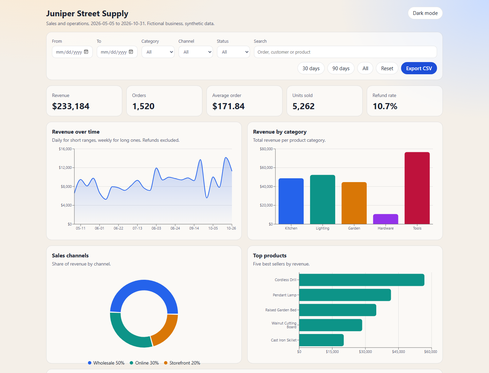

# react-analytics-dashboard

[](https://github.com/chasebuilds/react-analytics-dashboard/actions/workflows/ci.yml)
[](LICENSE)

A single-page sales and operations dashboard for a fictional small business, written in React and TypeScript. It shows the pieces most owners ask for: key figures, trend charts, a filterable orders table and a CSV export.

**Live demo:** https://chasebuilds.github.io/react-analytics-dashboard/



## What it does

- Five KPI cards: revenue, orders, average order, units sold, refund rate.
- Four charts (Recharts): revenue over time, revenue by category, channel share, top products.
- Filters: date range with 30 day / 90 day / all presets, category, channel, status and free-text search. Everything on the page updates together.
- Orders table with sortable columns and paging.
- CSV export of the rows currently filtered. Cells that start with `=`, `+`, `-` or `@` are prefixed so spreadsheets do not run them as formulas.
- Light and dark theme (follows the system, with a manual toggle).
- Responsive layout, keyboard-friendly controls, visible focus, skip link, labelled regions and table sort state exposed to screen readers.

## Data

All data is synthetic. `src/lib/data.ts` generates 180 days of orders (1,520 rows for the default seed) for "Juniper Street Supply", a made-up business, with a seeded random generator, so every visitor sees the same numbers. No real company or person is represented. To use real data, replace `generateOrders()` with a loader that returns `Order[]` (see `src/lib/types.ts`).

## Run it

```bash
npm ci
npm run dev      # local dev server
npm test         # Vitest unit tests
npm run lint     # ESLint
npm run build    # type-check and production build
```

## Project layout

| Path | Purpose |
| --- | --- |
| `src/lib/data.ts` | Seeded data generator |
| `src/lib/transforms.ts` | Filtering, KPIs, chart series, sorting, CSV (pure functions) |
| `src/lib/transforms.test.ts` | 13 unit tests for the above |
| `src/components/` | Charts and orders table |
| `.github/workflows/` | CI (lint, type-check, test, build) and Pages deploy |

TypeScript runs in strict mode with `noUncheckedIndexedAccess`. CI runs ESLint, `tsc --noEmit`, the tests and a production build on every push.

## Measured

- Production bundle: 697 KB minified JavaScript, 200 KB gzipped, plus 3.8 KB CSS (most of the JavaScript is Recharts).
- 13 unit tests, all in the data and transform layer.

## Limitations

- The data is generated in the browser, not fetched from an API or database. There is no login, saving or editing.
- The charts are not covered by automated tests, and there are no end-to-end browser tests.
- Chart accessibility is limited to titles, descriptions and tooltips. There is no data-table alternative for each chart.
- The JavaScript bundle is not code-split.
- Dates are plain `YYYY-MM-DD` strings in UTC; there is no time zone handling.
- Visually checked in current Edge at desktop width only; the phone layout is CSS-only and not tested on a device.

## License

MIT, see [LICENSE](LICENSE).

## More from Chase Builds

- **[automated-reporting-system](https://github.com/chasebuilds/automated-reporting-system)**: Weekly exports in, finished Excel report and dashboard out. Stops itself when the data looks wrong. ([live demo](https://chasebuilds.github.io/automated-reporting-system/))
- **[data-quality-checks](https://github.com/chasebuilds/data-quality-checks)**: Catches bad data before it reaches a report. 1,784 of 1,800 planted faults caught, 0 false alarms. ([live demo](https://chasebuilds.github.io/data-quality-checks/))
- **[housing-market-trends](https://github.com/chasebuilds/housing-market-trends)**: Monthly market metrics and a time-adjustment rate with a confidence band. ([live demo](https://chasebuilds.github.io/housing-market-trends/))

[All projects, sorted by industry](https://github.com/chasebuilds) · [chasebuilds.github.io](https://chasebuilds.github.io)
